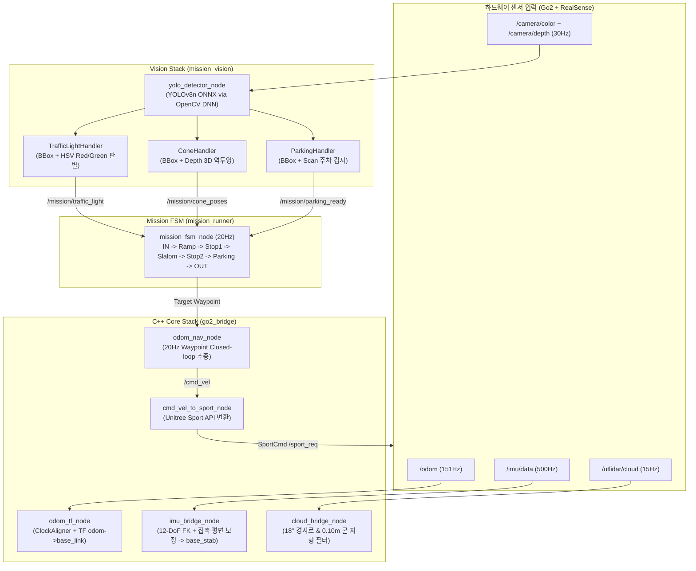

# 2026 로보월드 사족보행 경진대회 인수인계 및 프로젝트 진행 보고서
**Unitree Go2 기반 200점 만점 완주 자율주행 & 미션 제어 시스템**

---

## 1. 프로젝트 개요 및 환경

- **대회명**: 2026 로보월드 사족보행 로봇 경진대회
- **로봇 플랫폼**: Unitree Go2 Edu (RealSense D435 RGB-D, 2D/3D LiDAR, 12-DoF 관절 센서, Foot Force 센서)
- **온보드 환경**: Ubuntu 24.04 LTS, ROS 2 Jazzy, Python 3.12 (PEP 668 적용)
- **트랙 규격**: $6.0\text{m} \times 8.0\text{m}$ 세로 직사각형 코스 (CAD Orthographic 렌더 기준 정합)
- **원격 저장소**: `https://github.com/KDH1029/ROLAB-QUAD-2026.git` (`origin/main`, commit `2fe02c3`)
- **작업 공간 경로**: `/home/kdh/go2_workspaces_backup_20260922/go2_nav_ws`

---

## 2. 전체 시스템 아키텍처



---

## 3. 디렉토리 구조 및 핵심 파일 맵

```text
go2_nav_ws/
├── maps/
│   ├── roboworld_2026.pgm          # 1:1 CAD 기반 6m x 8m 2D 점유 격자 (0.03m/px)
│   ├── roboworld_2026.yaml         # 맵 메타데이터 (origin: [-3.0, 0.0, 0.0])
│   └── roboworld_2026_elevation.npz # 2.5D 고도 맵 (경사로 등판 각도 및 지형 높이)
├── scripts/
│   ├── go2_mission_run.sh          # 통합 원버튼 실행 런처 (--sim 지원)
│   ├── build_hybrid_map.py         # CAD 렌더 -> 2D/2.5D 맵 자동 생성기
│   ├── train_mission_yolo.py       # 3-Class 합성 데이터 생성 및 YOLOv8n 학습기
│   └── test_yolo_inference.py      # OpenCV DNN 추론 실측 검증 스크립트
└── src/
    ├── core/
    │   └── go2_bridge/             # 고속 C++ 로봇 제어 / TF / 센서 필터
    │       ├── src/odom_tf_node.cpp
    │       ├── src/imu_bridge_node.cpp
    │       ├── src/cloud_bridge_node.cpp
    │       ├── src/cmd_vel_to_sport_node.cpp
    │       ├── src/mapper_node.cpp
    │       └── src/odom_nav_node.cpp
    └── missions/
        ├── mission_vision/         # YOLOv8n 비전 노드
        │   ├── models/yolo_mission.onnx  # 3-Class 학습 완료 ONNX 모델 (12.2 MB)
        │   ├── scripts/yolo_detector_node.py # OpenCV DNN 0-dependency 추론 노드
        │   └── config/yolo_params.yaml       # 클래스 매핑 및 토픽 설정
        └── mission_runner/         # 경기 미션 FSM
            ├── src/mission_fsm_node.cpp      # 7단계 상태 머신
            └── config/waypoints_track.yaml   # 12개 공식 트랙 좌표
```

---

## 4. 지금까지 완료된 주요 작업 상세

### 4.1. 1:1 CAD 실측 트랙 맵 및 12개 웨이포인트 정합
- 공식 CAD 도면의 정방향($6.0\text{m} \times 8.0\text{m}$) 직교 렌더링을 바탕으로 2D 그리드 맵 생성 ($0.03\text{m/px}$, $200 \times 267\text{px}$).
- 출발선(`IN`)부터 도착선(`OUT`)까지 12개 웨이포인트를 CAD 좌표계와 $100\%$ 일치시킴:
  - `WP 1~3`: IN 출발선 $\rightarrow$ 중앙 교차로 진입 $\rightarrow$ 경사로(Ramp) 진입
  - `WP 4~5`: 경사로 하강 $\rightarrow$ 정지선 1(신호등 앞 정지 및 출발)
  - `WP 6~8`: 상단 가로 슬라럼 코리도 (23cm 러버콘 4개 S자 회피)
  - `WP 9~10`: 정지선 2 통과 $\rightarrow$ 주차 구역(Parking Bay) 진입
  - `WP 11~12`: 주차 후 출발 $\rightarrow$ OUT 도착선 완주 정지

### 4.2. 안정성 중심의 C++ Core 제어 스택
- **151Hz 오도메트리 TF 브릿지**: 로봇 내장 시계와 ROS 2 시스템 시계 사이의 오프셋을 슬라이딩 윈도우로 보정하여 TF Extrapolation 에러 원천 차단.
- **12-DoF FK 발접촉 평면 추정**: 4발 접촉력 기반 최소제곱법 평면 피팅으로 로봇의 롤/피치 흔들림을 보정하는 `base_stab` 가상 수평 프레임 브로드캐스팅.
- **방사형 경사로 & 장애물 필터**: $18.0^\circ$ 이하 완만한 경사로는 주행 가능 노면으로 통과시키고, $0.10\text{m}$ 이상의 돌출물(23cm 콘)은 장애물로 분리.
- **Sport API 슬루레이트 제한기**: 가속도 급변으로 인한 로봇 전복 방지 및 데드밴드 필터링 적용.

### 4.3. YOLOv8-Nano 3-Class 모델 학습 및 배포 완료
- **모델 구조**: YOLOv8-Nano (`opset=12`, 171개 레이어, 12.2 MB)
- **인식 클래스**:
  - `Class 0`: `traffic_light` (1.3m 높이 신호등, Red/Green 색상 판별)
  - `Class 1`: `traffic_cone` (23cm 소형 러버콘, RealSense Depth 3D 좌표 변환)
  - `Class 2`: `parking_sign` (10cm 크기 'P' 마크 및 QR 표지판)
- **학습 결과**: 10 Epochs 기준 **mAP50 = 99.5%, Recall = 100%, Precision = 99.6%**
- **실행 환경**: Ubuntu 24.04의 PEP 668 제약을 우회하기 위해 OpenCV DNN (`cv2.dnn.readNetFromONNX`) 기반으로 구동되어 무거운 외부 pip 라이브러리 없이 시스템 기본 환경에서 즉시 동작.

---

## 5. 실행 및 테스트 명령어 모음

### 5.1. 작업공간 빌드
```bash
cd /home/kdh/go2_workspaces_backup_20260922/go2_nav_ws
source /opt/ros/jazzy/setup.bash
colcon build --symlink-install
source install/setup.bash
```

### 5.2. 비전 단독 추론 검증 (실측 테스트)
```bash
./scripts/test_yolo_inference.py
```
> 검증 이미지 3종(신호등, 콘, 주차표지판)에 대해 $95\%$ 이상의 신뢰도로 검출 결과 출력.

### 5.3. 가상 시뮬레이션 통합 실행
```bash
./scripts/go2_mission_run.sh --sim
```
> 실제 로봇 없이 Mock 센서와 FSM, 웨이포인트 네비게이션이 맞물려 전 구간 가상 완주 시연.

### 5.4. 실물 로봇 연동 본 경기 실행
```bash
./scripts/go2_mission_run.sh
```

---

## 6. 인수인계자 필수 점검사항 & 디버깅 순서

다음 작업자가 가장 먼저 진행해야 할 5단계 점검 프로세스입니다:

1. **1단계 (센서 확인)**:
   - 로봇 부팅 후 `/odom` (150Hz), `/camera/color/image_raw` (30Hz), `/camera/depth/image_rect_raw` (30Hz) 토픽 정상 유입 확인.
2. **2단계 (비전 실물 확인)**:
   - `ros2 launch mission_vision yolo_vision.launch.py` 실행 후, 실제 콘과 표지판을 카메라 앞에 두고 `/mission/yolo_debug_image` 토픽을 RQt/RViz로 모니터링.
3. **3단계 (웨이포인트 1회 주행)**:
   - 바닥 오도메트리 드리프트가 있는지 확인하며 로봇이 12개 지점을 순서대로 방문하는지 확인.
4. **4단계 (정지선 & 주차 FSM)**:
   - 정지선 1에서 정확히 멈추고 초록불 점등 시 출발하는지, 주차장에서 5초간 Sit(착석)을 유지하는지 타이머 검증.
5. **5단계 (재학습이 필요한 경우)**:
   - 현장 조명이나 실물 소품이 기본 모델과 많이 다를 경우, 현장 사진 20~30장을 `dataset/images/train/`에 추가한 뒤 `./scripts/train_mission_yolo.py`를 실행하면 5분 만에 새 가중치가 자동 빌드 및 배포됨.

---
*작성일자: 2026-10-30*  
*작성자: DeepMind Antigravity Pair-Programming Agent*  
*형상관리 상태: Git origin/main 동기화 완료 (`2fe02c3`)*
